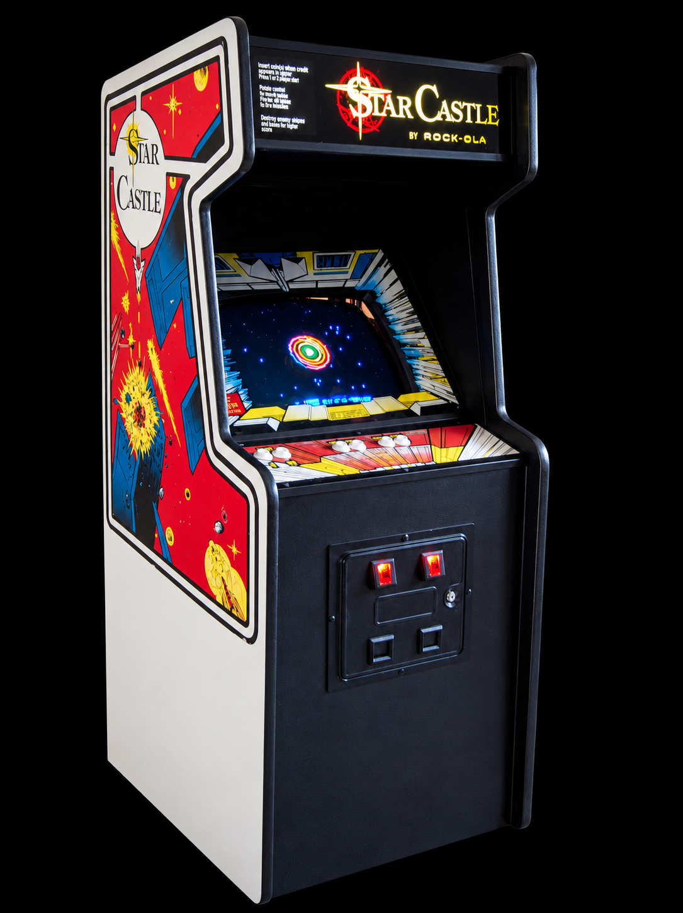
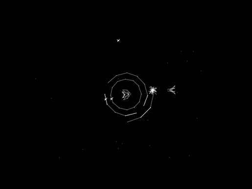

# Cinematronics vector arcade hardware for MiSTer FPGA

An FPGA implementation of Cinematronics vector arcade hardware for the
[MiSTer FPGA](https://github.com/MiSTer-devel/Main_MiSTer/wiki) platform,
supporting **Star Castle (version 3)**, **Rip Off** and **Armor Attack** (1980) in one RBF.

Defend your ship against the central cannon, breaking through its rotating
shield rings while avoiding mines. The core recreates the CCPU, vector display
and discrete sound, with a colour filter based on the original screen gels.
Rip Off adds simultaneous two-player defence of the fuel supply.
Armor Attack adds two-player jeep combat through a city playfield. Solar Quest is planned next.

  
  

> **Status:** Star Castle gameplay was confirmed on the previous two-game build.
> **Rip Off is bootable but otherwise untested/WIP**: it boots and plays on
> MiSTer, but gameplay, two-player operation and sound have not been validated.
> **Armor Attack boots and plays, but remains WIP** with city overlay and synthesized sound;
> its sound balance and detailed artwork alignment are confirmed by user testing.
> Two-player operation needs testing. The current three-game
> build passes simulation, fitting and reported internal timing. Beam/glow
> appearance is confirmed by user testing.
>
> **Known issues:** **CRT output is untested.** Star Castle's revised explosion
> levels still need listening confirmation. Physical colour,
> vector timing and analog sound fidelity remain uncalibrated. Feedback and
> bug reports are welcome via [Issues](https://github.com/Usquebagh/Arcade-Cinematronics_MiSTer/issues).

---

## Original Hardware

| Subsystem | Original Hardware | FPGA Implementation |
| --- | --- | --- |
| CPU | Cinematronics CCPU, two 12-bit accumulators | SystemVerilog CCPU, checked against the pinned MAME instruction reference |
| Program | Four ROM chips, 8 or 16 KiB total | Writable program ROM, loaded through the MRA |
| Video | Monochrome vector display with coloured screen gels | 512x384 raster framebuffer, 16 source intensity levels, adjustable beam glow, Star Castle colour filter and Armor Attack city overlay |
| Sound | Game-specific discrete sound boards | Synthesized oscillators, noise and envelopes: Star Castle, Rip Off and Armor Attack models; signed mono audio |

## Controls

| Action | Keyboard | Controller |
| --- | --- | --- |
| Rotate | Left/Right | Left/Right |
| Thrust / Forward | Up | Thrust button or Up |
| Fire | Space | Fire button |
| Coin | 5 | Coin button |
| Start 1 | 1 | Controller 1 Start |
| Start 2 | 2 | Start 2 button or Controller 2 Start |

For Rip Off and Armor Attack, each controller operates its own player. Player 2 keyboard controls
are **A/D** to rotate, **W** to thrust and **F** to fire.

The OSD provides **Beam brightness**, **Glow amount**, **Glow spread**,
**Screen overlay**, **Overlay strength** and **Detailed artwork**. Glow adds
soft light around the sharp vector lines; the default is Medium/Soft. Overlay
controls appear only for Star Castle and Armor Attack; Detailed artwork appears
only for Armor Attack. For Armor Attack, On adds transparent building detail;
Off retains the plain city view.
Use MiSTer's **Save settings** to retain your choices. See
[video controls](docs/colour.md) for details.
Rip Off uses monochrome output with adjustable brightness. Armor Attack adds a static city/road overlay.

## ROMs and Installation

Download the actual files using the links below and copy them to your MiSTer SD card:

| File | Destination |
| --- | --- |
| [Arcade-Cinematronics_20261011.rbf](https://github.com/Usquebagh/Arcade-Cinematronics_MiSTer/raw/refs/heads/main/releases/Arcade-Cinematronics_20261011.rbf) | `_Arcade/cores/` |
| [Star Castle (version 3).mra](https://github.com/Usquebagh/Arcade-Cinematronics_MiSTer/raw/refs/heads/main/releases/Star%20Castle%20%28version%203%29.mra) | `_Arcade/` |
| [Rip Off.mra](https://github.com/Usquebagh/Arcade-Cinematronics_MiSTer/raw/refs/heads/main/releases/Rip%20Off.mra) | `_Arcade/` |
| [Armor Attack.mra](https://github.com/Usquebagh/Arcade-Cinematronics_MiSTer/raw/refs/heads/main/releases/Armor%20Attack.mra) | `_Arcade/` |
| Your own `starcas.zip` | `_Arcade/mame/` |
| Your own `ripoff.zip` | `_Arcade/mame/` |
| Your own `armora.zip` | `_Arcade/mame/` |

Launch any game through its MRA; all three select the same RBF. From a GitHub
file page, use **Download raw file**; saving the webpage creates an unusable HTML file.
Keep only the current Cinematronics RBF
in `cores/`. See [release details](releases/README.md) for build information
and installation troubleshooting.

Game ROMs and scanned manuals are not included or distributed with this
repository. The credited Armor Attack transparency is included under
[artwork provenance](assets/armor_attack/README.md).

## Compilation and Tests

From Linux or WSL, run `bash build.sh`. It uses Quartus Prime Lite 17.0.2 in
`theypsilon/quartus-lite-c5:17.0.2` and checks fitting and reported timing.
The output is `output_files/Arcade-Cinematronics.rbf`.

[Validation](docs/validation.md) lists test commands and results. CI uses
synthetic programs and requires no game ROMs. Technical details are in
[architecture](docs/architecture.md), [MiSTer integration](docs/mister-integration.md),
[Star Castle sound](docs/sound.md), [Rip Off](docs/ripoff.md),
[Armor Attack](docs/armor-attack.md), [colour](docs/colour.md) and [roadmap](docs/roadmap.md).

## Credits

- Aaron Giles and MAME: CCPU instruction reference and Cinematronics board definitions.
- MAME contributors: Star Castle sound-circuit and colour-filter references.
- MiSTer developers: platform framework, imported through the Fire Trap core.
- Videodr0me: [Star Wars renderer](https://github.com/Videodr0me/Arcade-StarWars_MiSTer) reference for adjustable beam/glow options.
- Hardware documentation authors: original CPU, board and circuit references.
- [ArcadeArtwork.org](https://www.arcadeartwork.org/picture.php?/99140): Armor Attack transparent town artwork.

See [reference provenance](docs/references.md) for source revisions and licenses.

## License

The integrated MiSTer core is [GPL-3.0-or-later](LICENSE). Original CPU,
machine, video modules and tools remain
[BSD-3-Clause](LICENSES/Cinematronics-BSD-3-Clause.txt) individually.
Imported components retain their respective licenses and credits.
Artwork provenance and rights are recorded separately in the asset folder.
